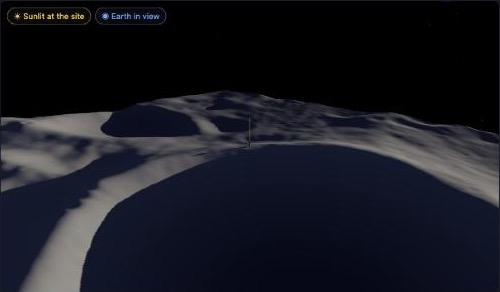
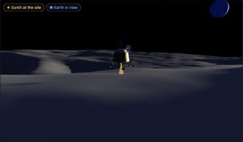

# Lunar Site Planner

**Where and when can a lunar lander get power and talk to Earth?**

Lunar Site Planner lets mission planners, educators and anyone curious compare landing sites and dates in seconds. Pick a site and a time range. The planner works out where the Sun and the Earth are in that site's sky. It checks them against the real local skyline and tells you how long a lander has sunlight and a direct radio link to Earth.

Built for the NASA Space Apps Challenge. The challenge statement is in [docs/challenge.md](docs/challenge.md).

>
> The demo backend runs on a free server that sleeps when idle. The first request after a pause can take about a minute while it wakes up.


## Why it matters

At the Moon's south pole the Sun never climbs more than a degree or two above the horizon. A crater rim a few kilometres away can hide it for days. The Earth wobbles up and down near the horizon over a month (libration), so direct contact comes and goes. Moving a landing site by a few kilometres, or a launch by a couple of weeks, can turn a viable mission into an impossible one.

Today this takes several specialist tools: JPL Horizons for ephemerides, LOLA data or QuickMap for terrain, and spreadsheets to put them together. Lunar Site Planner answers the question directly, in one screen.

## What it does

- **Landing search.** Open **Planner → Landing search** to compare south polar sites by terrain, sunlight, Earth contact and hydrogen. Switch between the existing 3D walkthrough and a relief map with ranked candidates. Search settings accept a period, radius and sampling grid; an incoming Planner scenario supplies the initial period. Candidate links open Analysis or Mission Control with the displayed result's coordinates and dates. Without an incoming scenario, the page starts with the labelled saved 2027 calculation. If a live request fails, it shows the saved result's actual settings. Download the hydrogen map with `python -m app.scripts.fetch_resources` and refresh the offline result with `python -m app.scripts.precompute_landing` from `backend/`. See [Landing search presentations](docs/landing-search.md) for data sources and limits.


- **Mission Control.** The site opens straight into a fullscreen view. Every time Mission Control opens it starts from the whole Moon, lit by the Sun from its real direction at the start of the period, with every catalog site marked; the camera flies down to the chosen site on the same persistent globe. The measured LOLA patch and skyline rays share its coordinate frame, including lunar curvature. «Whole Moon» pulls back to the whole Moon and «Landing site» returns without resetting the timeline. Skip it with «Skip», Space, Enter or Esc; restart the entire sequence with «Replay from Moon»; the automatic flight is skipped with reduced motion. The lander touches down on real LOLA terrain under a descent HUD (altitude, descent rate, thrust), then the skyline is traced in front of you: 720 rays shoot out from the lander to where each meets the terrain, with live counts of rays and LOLA points (about 650 000 at the south pole) and the farthest skyline point. Then the lunar day plays by itself: sunlight, Earth visibility and the longest night count up for the part played so far, the visibility windows draw in as time passes, and the verdict is revealed at the end of the period, and glass panels show the verdict, what the Sun and the Earth are doing right now, and the visibility windows. Lines of sight run from the lander to the Sun and the Earth; when terrain hides one, the line stops on that ridge with a label such as "Hidden by terrain 240 m WSW (skyline +5.9°)". Keys: Space play, ←/→ time, 1–4 sites, D demo, F fullscreen, Esc to the planner. Link: `?show=1`.
- **Sky paths and terrain colours.** In Mission Control, open **Sky paths, map & quality**: the hemisphere shows real Sun and Earth paths for the selected period. Switch terrain colours between sunlight and Earth visibility. The map uses the same backend calculation as **Better spots nearby**, over a wider 21 × 21 grid at 2 km spacing. During playback it estimates the visible sample share so far; the final frame uses exact full-period durations. Colours are interpolated and individual grid nodes can be selected.
- **Scene quality.** Auto lowers DPR, shadows and geometry detail when frame rate drops. High adds solar bloom; Simplified disables shadows and the terrain map and is the default on touch devices with a coarse pointer or limited resources. The current profile and measured FPS appear below the scene; manual overrides are available.
- **Automatic show.** `?demo=1`, the **Demo** button or the D key plays a hands-free tour for presenting and recording: the south pole, Mons Malapert and IM-1 over the same lunar day, with captions whose numbers come from the analysis on screen, ending on a side-by-side summary.
- **Any site, any dates.** Pick from 19 catalogued sites, or enter any coordinates and any date range from hours to years. The catalog covers Apollo, CLPS (IM-1, IM-2, Blue Ghost), Chang'e, Chandrayaan-3, SLIM, the south pole, Shackleton, and the Mons Mouton and Mons Malapert candidate regions.
- **Real ephemerides.** Sun and Earth azimuth and elevation come from **JPL Horizons** for an observer standing on the lunar surface. Lunar libration and orbital geometry are included.
- **Real skylines.** South of 75°S the horizon is computed from **LRO LOLA** laser altimetry out to 200 km, including the Moon's curvature.
- **A verdict for your kind of mission.** Pick **Day only** (a lander that works through one stretch of daylight, as the CLPS landers do) or **Through the night** (one that must survive the lunar night). Each scenario gets green, yellow or red for that mission, with plain-language reasons. Switching recolours results and comparisons at once. Behind it are the share of time sunlit, with Earth in view, and both together, the longest stretch with both, the longest night and the longest gap without Earth.
- **Countdowns.** At any moment you see how long until sunset, Earthset, or the end of the power-and-link window.
- **Sky panorama.** The skyline silhouette with the Sun's and Earth's paths. You can see exactly which mountain blocks the Sun and when.
- **Timeline with playback.** Elevation curves and visibility lanes. Scrub or play the lunar day at up to a week per second.
- **3D landing site.** A three.js scene of the terrain around the site. Shadows are cast from the real Sun direction, the Earth hangs in the sky, and a lander touches down at the site.
- **Landing-date calendar.** A launch slipped: which date works now? The calendar lands the same mission at the site on every date for the next 3, 6 or 12 months and colours each one by the verdict, the work time from touchdown, sunlight or Earth visibility. Landing windows are listed by date, and a click on any square opens those dates as a scenario.
- **Side-by-side comparison.** Up to four scenarios, with the best value in each row highlighted. Use it for neighbouring sites on the same dates, or the same site on different dates.
- **For the public too.** One-click quick starts, a glossary and hints on every metric.

| Compare sites | 3D terrain and lighting | Landing |
|---|---|---|
|  |  |  |

## Example: one lunar day at the south pole

The scenario covers 14 November – 13 December 2026, with an hourly step and LOLA terrain:

| Site | Sunlight | Earth in view | Sun + Earth | Longest darkness |
|---|---|---|---|---|
| Lunar South Pole (Shackleton rim) | **75%** | 45% | 45% | **7.5 d** |
| Mons Malapert | 55% | **100%** | **55%** | 12.4 d |
| IM-1 Odysseus site | 43% | **100%** | 43% | 11.9 d |

The south pole site gets the most light but loses Earth for almost two weeks. Malapert keeps Earth in view the whole time. In December 2026 the floors of Shackleton and Haworth craters see neither the Sun nor the Earth: they sit in permanent shadow.

## How it works

```
JPL Horizons ──► Sun & Earth azimuth / elevation ─┐
                                                   ├─► visibility windows ─► metrics & verdict
LOLA polar DEM ──► skyline (horizon mask) ─────────┘
              └──► terrain patch ─► 3D scene
```

1. **Ephemerides.** For each scenario the backend asks the Horizons API for an observer table of the Sun (`10`) and the Earth (`399`). The observer is a point on the Moon (`coord@301`, geodetic longitude, latitude and altitude). Quantity 4 gives apparent azimuth and elevation. There is no atmosphere, so there is no refraction. Responses are cached on disk.
2. **Skyline.** From a point 2 m above the ground, rays are cast every 0.5° of azimuth out to 200 km across the LOLA `ldem_75s_120m` grid (120 m/pixel, 75–90°S). Every terrain sample is placed in 3D on the 1737.4 km sphere. The highest elevation angle along a ray is the skyline in that direction. Distant terrain sinks below the horizontal on its own, so curvature needs no special handling.
3. **Visibility.**
   - The Sun is a 0.2666° disc. For every time step we compute the fraction of the disc above the skyline. The Sun counts as up while its upper limb is visible.
   - The Earth counts as in view while its centre clears the skyline, by an optional margin.
   - Window edges are interpolated between samples.
4. **Verdict.** Both are computed for every scenario; the switch in the form picks which one is shown.
   - **Day only** looks at the longest stretch with both the Sun (power) and the Earth (direct link). **Green** from 10 days, **yellow** from 5, **red** below; for dates shorter than 10 days the bar is the selected period itself. A site where the Earth never rises (the far side, deep crater floors) is red with a note that it needs a relay satellite. Calibrated on catalog sites: IM-1 and Mons Malapert get 12–13 days, Apollo sites about 15, the south pole 13 days in some months and under 6 in others.
   - **Through the night:**
     - **Red:** sunlight below 40%, Earth below 20%, or a night longer than 100 h.
     - **Yellow:** sunlight below 75%, Earth below 50%, or a night longer than 24 h.
     - **Green:** otherwise.
5. **Landing dates.** One ephemeris and one skyline cover the whole span; every date is a slice of the same samples, summarised by the same code as a single scenario. When a mission ends between samples, we interpolate its endpoint so even missions shorter than one step cover their full duration. The day-only verdict of a landing date counts the stretch of Sun and Earth that is already open at touchdown, so landing just before sunrise is red even when the following days are good.
6. **3D view.** A ±20 km height grid around the site, in the site's local east-north-up frame, is rendered with three.js. A directional light comes from the Sun's direction at the selected moment.

**Checks against known facts:**
- **DEM heights.** Shackleton's floor comes out at about −2.8 km, its rim at the pole at +1.3 km, and Mons Mouton and Malapert at about +5 km. All three are consistent with published topography.
- **Lunar day.** Apollo 11 gets a ~14.8-day lunar day.
- **Permanent shadow.** Shackleton's floor gets no sunlight in our runs, as expected for a permanently shadowed region.
- **Earth visibility.** Mons Malapert keeps Earth in view throughout the month we tested. This matches its reputation as a site with near-continuous Earth visibility.

## Limitations

- **Terrain only near the south pole.** Real skylines exist only south of 75°S, where the polar DEM is. Elsewhere the horizon is a smooth sphere, and the app says so.
- **Coarse near-field terrain.** The 120 m grid smooths terrain within a few hundred metres of the lander. Boulders and small craters are not included.
- **Rays near the DEM edge.** For sites close to 75–80°S, rays that leave the DEM stop there. The far skyline may be slightly underestimated.
- **Approximate candidate regions.** Artemis III candidate regions are represented by the centres of their named features (Mons Mouton, Mons Malapert), not by precise landing ellipses.
- **3D shadows.** Shadows in the 3D view come only from terrain within 20 km. The verdict always uses the full 200 km skyline.
- **Geometry only.** The verdict reflects geometric visibility. There is no thermal, battery or link-budget model.

## Run it locally

| Part | Runtime | Main libraries | Folder |
|---|---|---|---|
| Backend | Python **3.11** | FastAPI 0.162, Pydantic 2.14, Uvicorn 0.54, httpx, NumPy 2.4, Rasterio 1.4, Pillow 12; pytest, Ruff | `backend/` |
| Frontend | Node.js **26** (≥ 22.12), TypeScript **7.0** | React 19.3, Vite 8.3, TanStack Query 5, three.js 0.187 + React Three Fiber 9.8 + drei 10.7; Vitest 5.1, Oxlint, Prettier | `frontend/` |

Python and Node versions are pinned in `backend/.python-version` and `frontend/.nvmrc`.

### Backend

```bash
cd backend
python3.11 -m venv .venv
source .venv/bin/activate
pip install -r requirements-dev.txt
cp .env.example .env
python -m app.scripts.fetch_dem   # LOLA south polar DEM, 116 MB, once
uvicorn app.main:app --reload
```

The API runs at http://localhost:8000, with interactive docs at http://localhost:8000/docs.

The DEM goes to `backend/data/dem/` and is not committed. Without it the backend still runs, but every horizon is flat (`horizon_kind: "sphere"`). On a slow connection, use the smaller grid:

```bash
python -m app.scripts.fetch_dem ldem_75s_240m
```

Then set `DEM_NAME=ldem_75s_240m` in `backend/.env`. That grid is 29 MB.

Tests and lint:

```bash
pytest
ruff check . && ruff format --check .
```

### Frontend

```bash
cd frontend
npm install
cp .env.example .env
npm run dev
```

The app runs at http://localhost:5173. Set `VITE_USE_MOCKS=true` in `frontend/.env` to browse the site catalog without a backend.

Checks:

```bash
npm test
npm run lint
npm run typecheck
npm run format:check
```

## Deploy on our server

We serve the frontend and API from our own server behind a reverse proxy.

1. Build the frontend with `cd frontend && npm ci && npm run build`. The production
   build uses the same origin for API requests unless `VITE_API_URL` is set. Keep the
   localhost value from `.env.example` only in your local development environment.
2. Serve `frontend/dist/` as static files, with `index.html` as the fallback for routes.
3. Build the API image from the repository root with `docker build -t lunar-api backend`.
   Run it with `docker run -d --name lunar-api -p 127.0.0.1:8000:8000 -v lunar-cache:/app/data/cache lunar-api`.
4. Proxy `/api/`, `/health`, `/docs` and `/openapi.json` to `http://127.0.0.1:8000`.
   Configure HTTPS and the domain on the reverse proxy. Verify `/health` after deployment.

Our production host serves **https://noctis-expelled.space**. Its Nginx configuration is
[`deploy/noctis.nginx.conf`](deploy/noctis.nginx.conf); the certificate is managed on the server.
The checkout is `/opt/lunar/src`, immutable frontend releases are under
`/var/www/lunar/releases/<commit>/`, and `/var/www/lunar/current` selects the active release.
Build with the Node version from `frontend/.nvmrc`, without a development `.env`.
Tag the API image with the same commit and use `--restart unless-stopped`; only
`127.0.0.1:8000` is published. Persist `/app/data/cache` in the `lunar-cache` Docker volume.
The image includes LOLA terrain, hydrogen data and precomputed catalog skylines.
For rollback, point the frontend symlink to the previous release and restart the previous
API image tag. Run `nginx -t` before reloading Nginx and check `/health` through HTTPS.

If the frontend and API use different domains, set `VITE_API_URL` before building
and pass the frontend origin in `CORS_ORIGINS` to the API container.

## API

| Endpoint | What it returns |
|---|---|
| `GET /api/landing-search` | Ranked south polar sites; `best` and `site_terrain` are null when none is eligible |
| `GET /api/sites` | Landing site catalog with coordinates and sources |
| `GET /api/ephemeris` | Sun and Earth azimuth / elevation over a time range (JPL Horizons) |
| `GET /api/horizon` | Skyline around a site: elevation for every 0.5° of azimuth; with `include_hits=true`, where each ray meets the terrain |
| `GET /api/terrain` | Height grid around a site for 3D views |
| `POST /api/analyze` | Time series, visibility windows, metrics and verdict for a scenario |
| `POST /api/nearby` | The same metrics on a grid of spots around a site (LOLA terrain only) |
| `POST /api/calendar` | The same mission landed on each of up to 366 consecutive dates: metrics and verdicts per date |

Full schemas are at `/docs` (OpenAPI). Field-by-field notes are in [docs/mvp-plan.md](docs/mvp-plan.md).

## Project structure

```
backend/
  app/api/          HTTP endpoints
  app/services/     Horizons client, analysis, caching
  app/terrain/      LOLA DEM reader, skyline and terrain patch
  app/data/         landing site catalog
  tests/            pytest suite (recorded Horizons responses, synthetic terrain)
frontend/
  src/features/     scenario panel, sky panorama, timeline, metrics, comparison, nearby map,
                    landing-date calendar, 3D scene
  src/api/          typed API client and queries
docs/               challenge, data resources, plan, images
```

## Data and credits

- [JPL Horizons](https://ssd.jpl.nasa.gov/horizons/): Sun and Earth positions.
- [LRO LOLA gridded data](https://pds-geosciences.wustl.edu/lro/lro-l-lola-3-rdr-v1/lrolol_1xxx/data/lola_gdr/polar/), PDS Geosciences Node: south polar topography.
- [IAU / USGS Gazetteer of Planetary Nomenclature](https://planetarynames.wr.usgs.gov/): feature centres and named landing stations.
- [NASA SVS CGI Moon Kit](https://svs.gsfc.nasa.gov/4720) (LRO LROC colour mosaic and LOLA relief, public domain): the globe in Mission Control.
- [NSSDC Apollo landing site coordinates](https://nssdc.gsfc.nasa.gov/planetary/lunar/lunar_sites.html) and [LROC](https://www.lroc.asu.edu/): landing coordinates.

Every catalog entry lists its own source. More notes are in [docs/resources.md](docs/resources.md).

## Contributing

Branch, commit and review rules for the team are in [CONTRIBUTING.md](CONTRIBUTING.md).

---

Built for the NASA Space Apps Challenge. Not an official NASA product. NASA does not endorse this project.

### Detailed lunar surface

Run `python -m app.scripts.fetch_detail` from `backend/` to install the LROC NAC
Shackleton–de Gerlache stereo DTM (3.5 m source pixels), its orthophoto, and the NASA
SVS 8K globe texture. The Docker build includes this step. Downloads stay outside Git.
Mission Control offers the ridge as a fourth site. Balanced and High progressively
load 8 km and 2 km terrain patches (257 nodes per side) as the camera approaches.
The full globe remains present. Simplified retains the lightweight overview.

NAC heights feed both the scene and the skyline calculations, with LOLA outside the
local footprint and a 120 m blend at its edges. The optional NAC image contains shadows
from its acquisition date; calculated lighting is the default. See
[the source and accuracy notes](docs/resources.md#подробная-поверхность-в-приложении).

The API warms the catalog's hourly Sun/Earth ephemerides in the background at startup and daily thereafter. The day cache fetches 90 days ahead. Deployment runs `python -m app.services.warm_ephemeris` before switching traffic and exits nonzero if any site fails; arbitrary dates and coordinates still fetch on demand. The background worker retries failed sites after 15 seconds, doubling the delay up to 5 minutes, and resumes daily refreshes after recovery. Concurrent identical Horizons requests share one fetch, including when a visitor disconnects. The upstream concurrency limit remains two: measurements with four and eight produced HTTP 503 responses.

At the edge of the LOLA DEM, dark terrain means missing data and a smooth-sphere fallback. The 3D view labels this explicitly and does not apply illumination colours to those cells.
