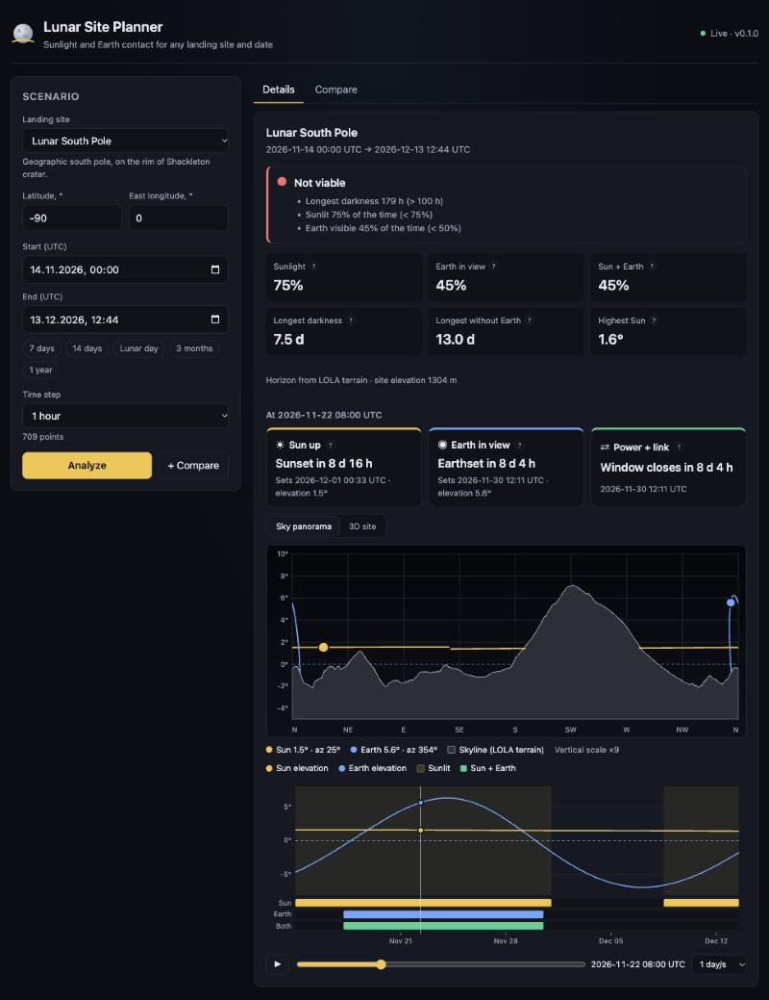
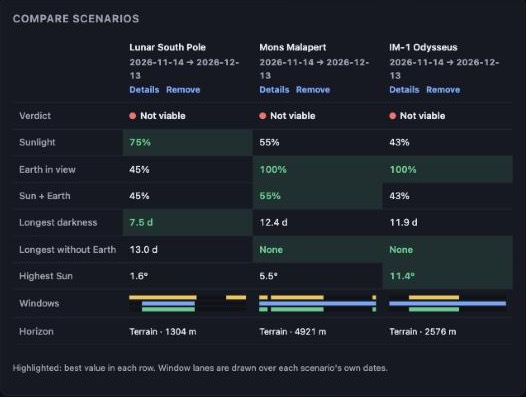

# Lunar Site Planner

**Where and when can a lunar lander get power and talk to Earth?**

Lunar Site Planner lets mission planners, educators and anyone curious compare landing sites and dates in seconds. Pick a site and a time range. The planner works out where the Sun and the Earth are in that site's sky. It checks them against the real local skyline and tells you how long a lander has sunlight and a direct radio link to Earth.

Built for the NASA Space Apps Challenge. The challenge statement is in [docs/challenge.md](docs/challenge.md).

> **Live demo:** coming soon.



## Why it matters

At the Moon's south pole the Sun never climbs more than a degree or two above the horizon. A crater rim a few kilometres away can hide it for days. The Earth wobbles up and down near the horizon over a month (libration), so direct contact comes and goes. Moving a landing site by a few kilometres, or a launch by a couple of weeks, can turn a viable mission into an impossible one.

Today this takes several specialist tools: JPL Horizons for ephemerides, LOLA data or QuickMap for terrain, and spreadsheets to put them together. Lunar Site Planner answers the question directly, in one screen.

## What it does

- **Any site, any dates.** Pick from 19 catalogued sites, or enter any coordinates and any date range from hours to years. The catalog covers Apollo, CLPS (IM-1, IM-2, Blue Ghost), Chang'e, Chandrayaan-3, SLIM, the south pole, Shackleton, and the Mons Mouton and Mons Malapert candidate regions.
- **Real ephemerides.** Sun and Earth azimuth and elevation come from **JPL Horizons** for an observer standing on the lunar surface. Lunar libration and orbital geometry are included.
- **Real skylines.** South of 75°S the horizon is computed from **LRO LOLA** laser altimetry out to 200 km, including the Moon's curvature.
- **A clear verdict.** Each scenario gets green, yellow or red, with plain-language reasons. Behind it are the share of time sunlit, with Earth in view, and both together, plus the longest night and the longest gap without Earth.
- **Countdowns.** At any moment you see how long until sunset, Earthset, or the end of the power-and-link window.
- **Sky panorama.** The skyline silhouette with the Sun's and Earth's paths. You can see exactly which mountain blocks the Sun and when.
- **Timeline with playback.** Elevation curves and visibility lanes. Scrub or play the lunar day at up to a week per second.
- **3D landing site.** A three.js scene of the terrain around the site. Shadows are cast from the real Sun direction, the Earth hangs in the sky, and a lander touches down at the site.
- **Side-by-side comparison.** Up to four scenarios, with the best value in each row highlighted. Use it for neighbouring sites on the same dates, or the same site on different dates.
- **For the public too.** One-click quick starts, a glossary and hints on every metric.

| Compare sites | 3D terrain and lighting | Landing |
|---|---|---|
|  |  |  |

## Example: one lunar day at the south pole

The scenario covers 14 November – 13 December 2026, with an hourly step and LOLA terrain:

| Site | Sunlight | Earth in view | Sun + Earth | Longest darkness |
|---|---|---|---|---|
| Lunar South Pole (Shackleton rim) | **75%** | 45% | 45% | **7.5 d** |
| Mons Malapert | 55% | **100%** | **55%** | 12.4 d |
| IM-1 Odysseus site | 43% | **100%** | 43% | 11.9 d |

The south pole site gets the most light but loses Earth for almost two weeks. Malapert keeps Earth in view the whole time. In December 2026 the floors of Shackleton and Haworth craters see neither the Sun nor the Earth: they sit in permanent shadow.

## How it works

```
JPL Horizons ──► Sun & Earth azimuth / elevation ─┐
                                                   ├─► visibility windows ─► metrics & verdict
LOLA polar DEM ──► skyline (horizon mask) ─────────┘
              └──► terrain patch ─► 3D scene
```

1. **Ephemerides.** For each scenario the backend asks the Horizons API for an observer table of the Sun (`10`) and the Earth (`399`). The observer is a point on the Moon (`coord@301`, geodetic longitude, latitude and altitude). Quantity 4 gives apparent azimuth and elevation. There is no atmosphere, so there is no refraction. Responses are cached on disk.
2. **Skyline.** From a point 2 m above the ground, rays are cast every 0.5° of azimuth out to 200 km across the LOLA `ldem_75s_120m` grid (120 m/pixel, 75–90°S). Every terrain sample is placed in 3D on the 1737.4 km sphere. The highest elevation angle along a ray is the skyline in that direction. Distant terrain sinks below the horizontal on its own, so curvature needs no special handling.
3. **Visibility.**
   - The Sun is a 0.2666° disc. For every time step we compute the fraction of the disc above the skyline. The Sun counts as up while its upper limb is visible.
   - The Earth counts as in view while its centre clears the skyline, by an optional margin.
   - Window edges are interpolated between samples.
4. **Verdict.**
   - **Red:** sunlight below 40%, Earth below 20%, or a night longer than 100 h.
   - **Yellow:** sunlight below 75%, Earth below 50%, or a night longer than 24 h.
   - **Green:** otherwise.
5. **3D view.** A ±20 km height grid around the site, in the site's local east-north-up frame, is rendered with three.js. A directional light comes from the Sun's direction at the selected moment.

**Checks against known facts:**
- **DEM heights.** Shackleton's floor comes out at about −2.8 km, its rim at the pole at +1.3 km, and Mons Mouton and Malapert at about +5 km. All three are consistent with published topography.
- **Lunar day.** Apollo 11 gets a ~14.8-day lunar day.
- **Permanent shadow.** Shackleton's floor gets no sunlight in our runs, as expected for a permanently shadowed region.
- **Earth visibility.** Mons Malapert keeps Earth in view throughout the month we tested. This matches its reputation as a site with near-continuous Earth visibility.

## Limitations

- **Terrain only near the south pole.** Real skylines exist only south of 75°S, where the polar DEM is. Elsewhere the horizon is a smooth sphere, and the app says so.
- **Coarse near-field terrain.** The 120 m grid smooths terrain within a few hundred metres of the lander. Boulders and small craters are not included.
- **Rays near the DEM edge.** For sites close to 75–80°S, rays that leave the DEM stop there. The far skyline may be slightly underestimated.
- **Approximate candidate regions.** Artemis III candidate regions are represented by the centres of their named features (Mons Mouton, Mons Malapert), not by precise landing ellipses.
- **3D shadows.** Shadows in the 3D view come only from terrain within 20 km. The verdict always uses the full 200 km skyline.
- **Geometry only.** The verdict reflects geometric visibility. There is no thermal, battery or link-budget model.

## Run it locally

| Part | Runtime | Main libraries | Folder |
|---|---|---|---|
| Backend | Python **3.11** | FastAPI 0.162, Pydantic 2.14, Uvicorn 0.54, httpx, NumPy 2.4; pytest, Ruff | `backend/` |
| Frontend | Node.js **26** (≥ 22.12), TypeScript **7.0** | React 19.3, Vite 8.3, TanStack Query 5, three.js 0.187 + React Three Fiber 9.8 + drei 10.7; Vitest 5.1, Oxlint, Prettier | `frontend/` |

Python and Node versions are pinned in `backend/.python-version` and `frontend/.nvmrc`.

### Backend

```bash
cd backend
python3.11 -m venv .venv
source .venv/bin/activate
pip install -r requirements-dev.txt
cp .env.example .env
python -m app.scripts.fetch_dem   # LOLA south polar DEM, 116 MB, once
uvicorn app.main:app --reload
```

The API runs at http://localhost:8000, with interactive docs at http://localhost:8000/docs.

The DEM goes to `backend/data/dem/` and is not committed. Without it the backend still runs, but every horizon is flat (`horizon_kind: "sphere"`). On a slow connection, use the smaller grid:

```bash
python -m app.scripts.fetch_dem ldem_75s_240m
```

Then set `DEM_NAME=ldem_75s_240m` in `backend/.env`. That grid is 29 MB.

Tests and lint:

```bash
pytest
ruff check . && ruff format --check .
```

### Frontend

```bash
cd frontend
npm install
cp .env.example .env
npm run dev
```

The app runs at http://localhost:5173. Set `VITE_USE_MOCKS=true` in `frontend/.env` to browse the site catalog without a backend.

Checks:

```bash
npm test
npm run lint
npm run typecheck
npm run format:check
```

## API

| Endpoint | What it returns |
|---|---|
| `GET /api/sites` | Landing site catalog with coordinates and sources |
| `GET /api/ephemeris` | Sun and Earth azimuth / elevation over a time range (JPL Horizons) |
| `GET /api/horizon` | Skyline around a site: elevation for every 0.5° of azimuth |
| `GET /api/terrain` | Height grid around a site for 3D views |
| `POST /api/analyze` | Time series, visibility windows, metrics and verdict for a scenario |

Full schemas are at `/docs` (OpenAPI). Field-by-field notes are in [docs/mvp-plan.md](docs/mvp-plan.md).

## Project structure

```
backend/
  app/api/          HTTP endpoints
  app/services/     Horizons client, analysis, caching
  app/terrain/      LOLA DEM reader, skyline and terrain patch
  app/data/         landing site catalog
  tests/            pytest suite (recorded Horizons responses, synthetic terrain)
frontend/
  src/features/     scenario panel, sky panorama, timeline, metrics, comparison, 3D scene
  src/api/          typed API client and queries
docs/               challenge, data resources, plan, images
```

## Data and credits

- [JPL Horizons](https://ssd.jpl.nasa.gov/horizons/): Sun and Earth positions.
- [LRO LOLA gridded data](https://pds-geosciences.wustl.edu/lro/lro-l-lola-3-rdr-v1/lrolol_1xxx/data/lola_gdr/polar/), PDS Geosciences Node: south polar topography.
- [IAU / USGS Gazetteer of Planetary Nomenclature](https://planetarynames.wr.usgs.gov/): feature centres and named landing stations.
- [NSSDC Apollo landing site coordinates](https://nssdc.gsfc.nasa.gov/planetary/lunar/lunar_sites.html) and [LROC](https://www.lroc.asu.edu/): landing coordinates.

Every catalog entry lists its own source. More notes are in [docs/resources.md](docs/resources.md).

## Contributing

Branch, commit and review rules for the team are in [CONTRIBUTING.md](CONTRIBUTING.md).

---

Built for the NASA Space Apps Challenge. Not an official NASA product. NASA does not endorse this project.
