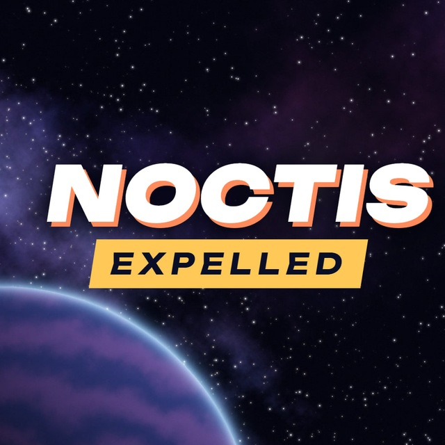
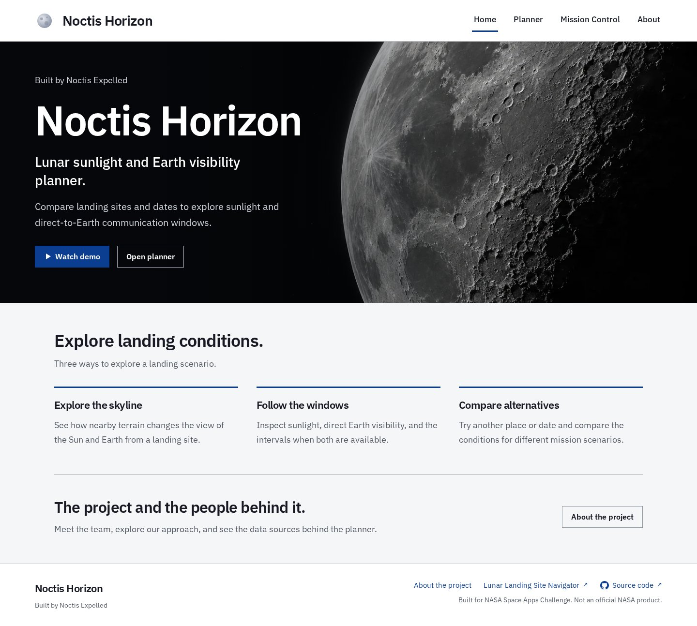
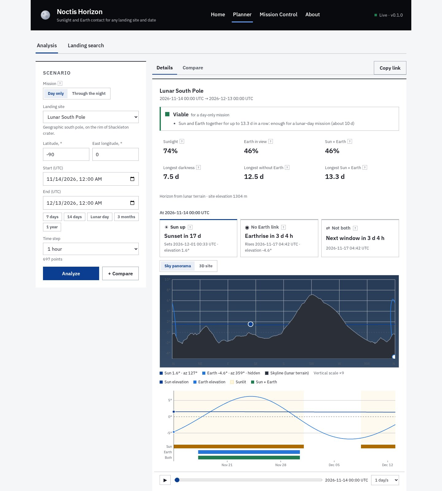
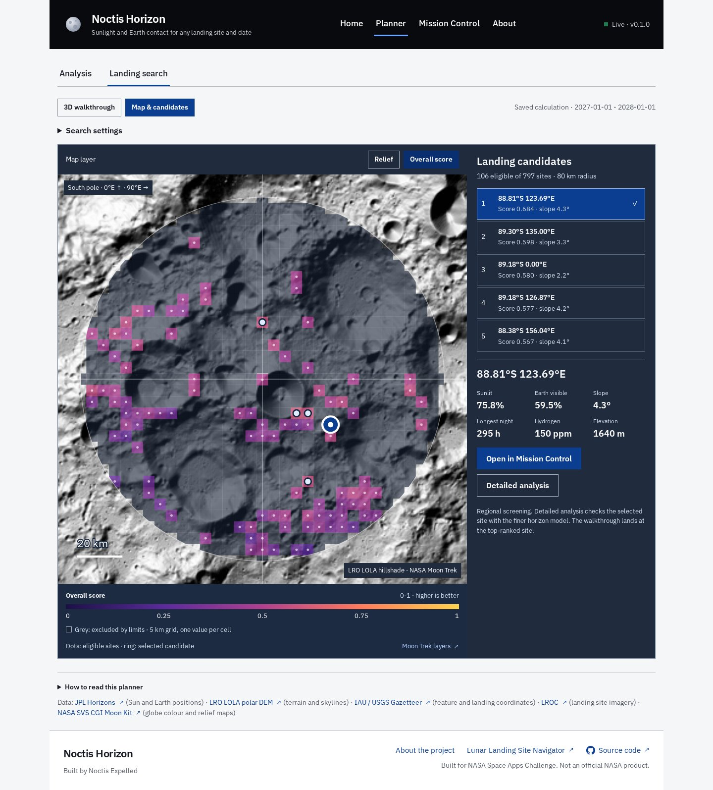
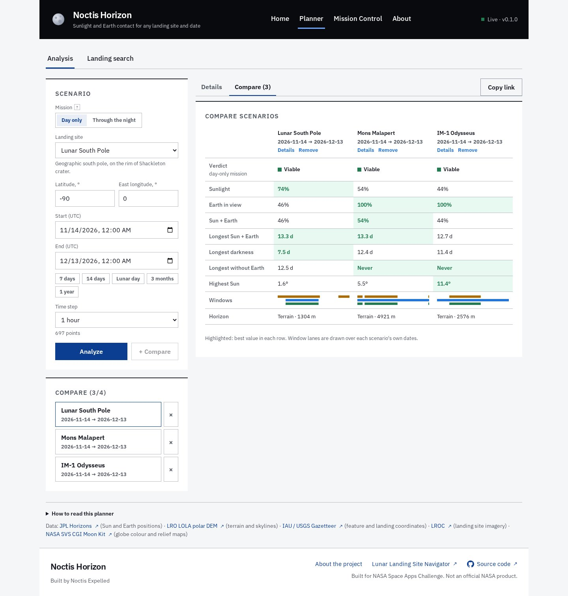
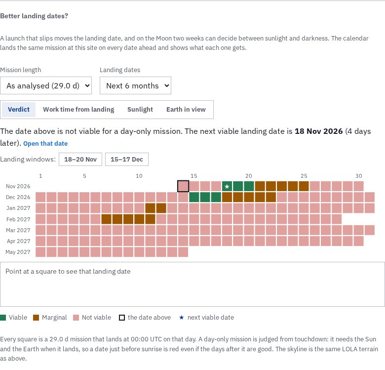
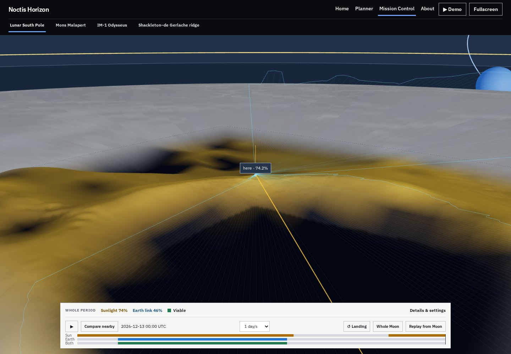
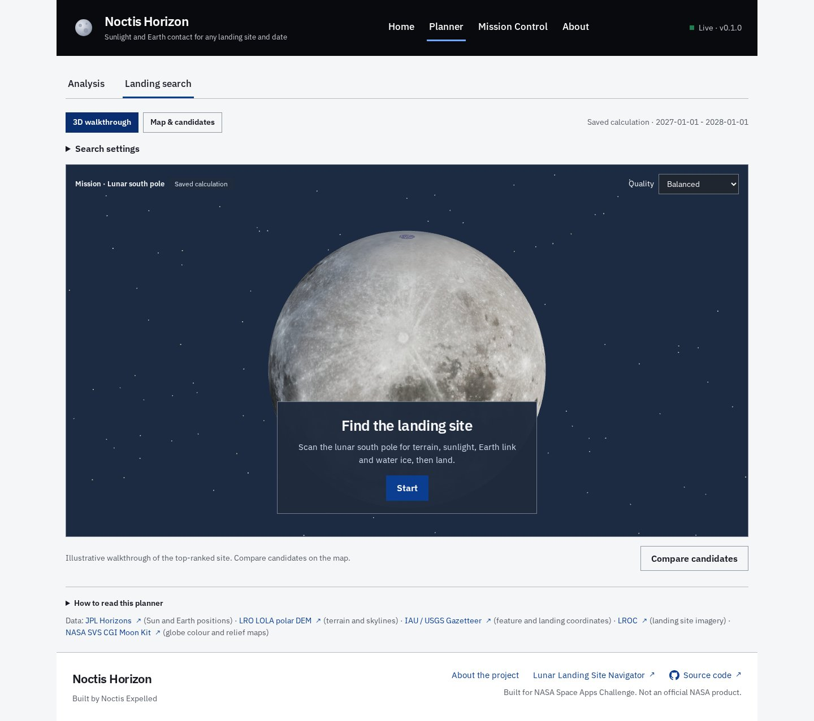
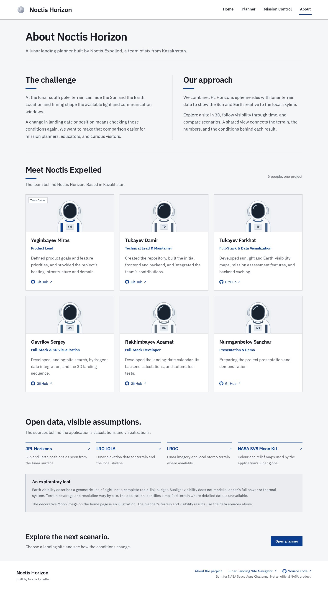

<p align="center">
  
</p>

# Noctis Horizon

**Lunar sunlight and Earth visibility planner, built by Noctis Expelled.**

**[Open the website](https://noctis-expelled.space/)** · [Challenge](docs/challenge.md) · [Data sources](docs/resources.md) · [Contributing](CONTRIBUTING.md)

Where and when can a lunar lander see the Sun and communicate directly with Earth? Noctis Horizon combines JPL Horizons ephemerides with lunar terrain to explore that question. Choose a site and dates, inspect the local skyline, and compare the periods with sunlight, Earth visibility, or both.

The project was built for the NASA Space Apps Challenge. It supports educational exploration and comparison of landing scenarios. Its visibility estimates do not include spacecraft power, thermal or radio engineering.



## Explore the project

| Feature | What you can do |
|---|---|
| **Analysis** | Choose a catalogued site or custom coordinates and a UTC period. Inspect visibility metrics, countdowns, sky paths and a timeline. Switch between day-only and overnight mission criteria. |
| **Compare** | Compare up to four scenarios, including different sites on the same dates or one site on different dates. Share scenarios with a URL. |
| **Landing-date calendar** | Try the same mission across later landing dates and inspect changes in sunlight, Earth contact and the time available from touchdown. |
| **Landing search** | Screen a south-polar region, inspect ranked candidates on a relief map or in an illustrative 3D walkthrough, then open a candidate in Analysis or Mission Control. |
| **Mission Control** | Explore a selected scenario in 3D, scrub through its period, inspect Sun and Earth paths, and compare nearby locations. Use the separate demo mode for a guided presentation. |
| **About** | Read about the problem, approach, data sources, model limits and the six-person team. |

The home page introduces the project and offers **Watch demo** and **Open planner**. Analysis and Landing search live together under `/planner`; Mission Control is the 3D view of a selected scenario.

### Analysis and regional search



Landing search can show **Overall score** on a Moon Trek relief map. Each coloured cell represents one sampled candidate; grey cells fail the search limits. Selecting a candidate preserves its coordinates and calculation period when opening the detailed tools.



Without an incoming scenario, Landing search opens a labelled saved calculation for 2027. **Search settings** requests a new calculation for the chosen period, radius and grid. The 3D walkthrough illustrates the search stages at the top-ranked site; its camera animation is a presentation of the result. See [Landing search](docs/landing-search.md) for the data flow and score-map limits.

<details>
<summary>More screenshots: comparison, calendar, 3D and About</summary>

### Compare sites and dates



### Find a later landing date



### Explore the selected scenario in Mission Control



### Present the landing search



### Meet the team



</details>

Screenshots were captured from a local build on 15 November 2026. [Capture details and reproduction](docs/screenshots.md).

## How the calculations work

1. **Positions:** JPL Horizons supplies Sun and Earth azimuth and elevation for an observer at the selected lunar coordinates and times.
2. **Skyline:** the backend traces terrain around the site to build a horizon mask. Regional coverage comes from the LOLA south-polar DEM; optional local NAC data adds detail where available.
3. **Visibility:** the Sun and Earth are checked against that skyline at each sampled time. The analysis derives visibility windows, the longest darkness and gaps in direct Earth contact.
4. **Mission criteria:** day-only and overnight scenarios apply different thresholds to those metrics. The verdict explains the selected criteria; the calendar evaluates availability from touchdown.
5. **Presentation:** the planner, comparison and 3D tools use backend results. Regional landing search uses a coarser screening model; opening a candidate requests its detailed analysis.

See [data and model notes](docs/resources.md) and the [API plan](docs/mvp-plan.md) for implementation details.

## Model limits

- **Visibility is geometric.** Sunlight and Earth contact are inputs to a mission design. Batteries, solar-panel output, thermal survival, antenna pointing and link budgets are outside this model.
- **Terrain coverage varies.** The regional DEM covers latitudes south of 75°S. Outside the available terrain, the app labels a smooth-sphere horizon. Near coverage edges, distant terrain can be missed.
- **Resolution matters.** The standard LOLA grid has 120 m pixels and misses smaller obstacles. Optional NAC data covers a limited footprint; it does not provide that detail everywhere.
- **3D and map imagery have separate roles.** Scene shadows use a local terrain patch, while visibility analysis uses the wider skyline. Moon Trek hillshade is a static relief background, not sunlight for the selected dates.
- **Search scores are screening aids.** Grid spacing, time sampling and eligibility settings affect the result. Hydrogen is a proxy from Lunar Prospector data, not confirmation of accessible water ice.
- **Results describe the chosen period.** A short calculation with no sunlight does not establish permanent shadow.

## Run it locally

| Part | Runtime | Main libraries | Folder |
|---|---|---|---|
| Backend | Python **3.11** | FastAPI, Pydantic, NumPy, Rasterio, httpx; pytest, Ruff | `backend/` |
| Frontend | Node.js **26**, TypeScript | React, Vite, TanStack Query, three.js, React Three Fiber, drei; Vitest, Oxlint, Prettier | `frontend/` |

Python and Node versions are pinned in `backend/.python-version` and `frontend/.nvmrc`.

### Backend

```bash
cd backend
python3.11 -m venv .venv
source .venv/bin/activate
pip install -r requirements-dev.txt
cp .env.example .env
python -m app.scripts.fetch_dem   # LOLA south polar terrain, downloaded once
python -m app.scripts.fetch_resources   # Hydrogen map for live landing search
uvicorn app.main:app --reload
```

The API runs at http://localhost:8000, with interactive docs at http://localhost:8000/docs.

The DEM goes to `backend/data/dem/` and is not committed. Without it the backend still runs, but every horizon is flat (`horizon_kind: "sphere"`). On a slow connection, use the smaller grid:

```bash
python -m app.scripts.fetch_dem ldem_75s_240m
```

Then set `DEM_NAME=ldem_75s_240m` in `backend/.env`. That grid is 29 MB.

Tests and lint:

```bash
pytest
ruff check . && ruff format --check .
```

### Frontend

```bash
cd frontend
npm ci
cp .env.example .env
npm run dev
```

The app runs at http://localhost:5173. Set `VITE_USE_MOCKS=true` in `frontend/.env` to browse the site catalog without a backend.

Checks:

```bash
npm test
npm run lint
npm run typecheck
npm run format:check
```

## Deployment

We serve the frontend and API from our own server behind a reverse proxy.

1. Build the frontend with `cd frontend && npm ci && npm run build`. The production
   build uses the same origin for API requests unless `VITE_API_URL` is set. Keep the
   localhost value from `.env.example` only in your local development environment.
2. Serve `frontend/dist/` as static files, with `index.html` as the fallback for routes.
3. Build the API image from the repository root with `docker build -t lunar-api backend`.
   Run it with `docker run -d --name lunar-api -p 127.0.0.1:8000:8000 -v lunar-cache:/app/data/cache lunar-api`.
4. Proxy `/api/`, `/health`, `/docs` and `/openapi.json` to `http://127.0.0.1:8000`.
   Configure HTTPS and the domain on the reverse proxy. Verify `/health` after deployment.

Our production host serves **https://noctis-expelled.space**. Its Nginx configuration is
[`deploy/noctis.nginx.conf`](deploy/noctis.nginx.conf); the certificate is managed on the server.
The checkout is `/opt/lunar/src`, immutable frontend releases are under
`/var/www/lunar/releases/<commit>/`, and `/var/www/lunar/current` selects the active release.
Build with the Node version from `frontend/.nvmrc`, without a development `.env`.
Tag the API image with the same commit and use `--restart unless-stopped`; only
`127.0.0.1:8000` is published. Persist `/app/data/cache` in the `lunar-cache` Docker volume.
The image includes LOLA terrain, hydrogen data and precomputed catalog skylines.
For rollback, point the frontend symlink to the previous release and restart the previous
API image tag. Run `nginx -t` before reloading Nginx and check `/health` through HTTPS.

If the frontend and API use different domains, set `VITE_API_URL` before building
and pass the frontend origin in `CORS_ORIGINS` to the API container.

## API

| Endpoint | What it returns |
|---|---|
| `GET /api/landing-search` | Ranked south polar sites; `best` and `site_terrain` are null when none is eligible |
| `GET /api/sites` | Landing site catalog with coordinates and sources |
| `GET /api/ephemeris` | Sun and Earth azimuth / elevation over a time range (JPL Horizons) |
| `GET /api/horizon` | Skyline around a site: elevation for every 0.5° of azimuth; with `include_hits=true`, where each ray meets the terrain |
| `GET /api/terrain` | Height grid around a site for 3D views |
| `POST /api/analyze` | Time series, visibility windows, metrics and verdict for a scenario |
| `POST /api/nearby` | The same metrics on a grid of spots around a site (LOLA terrain only) |
| `POST /api/calendar` | The same mission landed on each of up to 366 consecutive dates: metrics and verdicts per date |

Full schemas are at `/docs` (OpenAPI). Field-by-field notes are in [docs/mvp-plan.md](docs/mvp-plan.md).

## Project structure

```text
backend/
  app/api/          HTTP endpoints
  app/services/     Horizons client, analysis, caching
  app/terrain/      LOLA DEM reader, skyline and terrain patch
  app/data/         landing site catalog
  tests/            pytest suite (recorded Horizons responses, synthetic terrain)
frontend/
  src/features/     scenario panel, sky panorama, timeline, metrics, comparison, nearby map,
                    landing-date calendar, 3D scene
  src/api/          typed API client and queries
docs/               challenge, data resources, plan, images
```

## Data and credits

- [JPL Horizons](https://ssd.jpl.nasa.gov/horizons/): Sun and Earth positions.
- [LRO LOLA gridded data](https://pds-geosciences.wustl.edu/lro/lro-l-lola-3-rdr-v1/lrolol_1xxx/data/lola_gdr/polar/), PDS Geosciences Node: south polar topography.
- [NASA Moon Trek](https://trek.nasa.gov/moon/): the static LOLA hillshade basemap in Landing search. [Layer and projection notes](docs/landing-search.md#relief-map).
- [Lunar Prospector reduced data](https://pds-geosciences.wustl.edu/missions/lunarp/reduced/): the hydrogen map used in regional screening.
- [IAU / USGS Gazetteer of Planetary Nomenclature](https://planetarynames.wr.usgs.gov/): feature centres and named landing stations.
- [NASA SVS CGI Moon Kit](https://svs.gsfc.nasa.gov/4720) (LRO LROC colour mosaic and LOLA relief, public domain): the globe in Mission Control.
- [NSSDC Apollo landing site coordinates](https://nssdc.gsfc.nasa.gov/planetary/lunar/lunar_sites.html) and [LROC](https://www.lroc.asu.edu/): landing coordinates.

Every catalog entry lists its own source. More notes are in [docs/resources.md](docs/resources.md).

## Optional detailed lunar surface

Run `python -m app.scripts.fetch_detail` from `backend/` to install the LROC NAC
Shackleton-de Gerlache stereo DTM (3.5 m source pixels), its orthophoto, and the NASA
SVS 8K globe texture. The Docker build includes this step. Downloads stay outside Git.
Mission Control offers the ridge as a fourth site. Balanced and High progressively
load 8 km and 2 km terrain patches (257 nodes per side) as the camera approaches.
The full globe remains present. Simplified retains the lightweight overview.

NAC heights feed both the scene and the skyline calculations, with LOLA outside the
local footprint and a 120 m blend at its edges. The optional NAC image contains shadows
from its acquisition date; calculated lighting is the default. See
[the source and accuracy notes](docs/resources.md#подробная-поверхность-в-приложении).

At the edge of the LOLA DEM, dark terrain means missing data and a smooth-sphere fallback. The 3D view labels this explicitly and does not apply illumination colours to those cells.

## Ephemeris cache

The API warms the catalog's hourly Sun/Earth ephemerides in the background at startup and daily thereafter. The day cache fetches 90 days ahead. Deployment runs `python -m app.services.warm_ephemeris` before switching traffic and exits nonzero if any site fails; arbitrary dates and coordinates still fetch on demand. The background worker retries failed sites after 15 seconds, doubling the delay up to 5 minutes, and resumes daily refreshes after recovery. Concurrent identical Horizons requests share one fetch, including when a visitor disconnects. Upstream concurrency is limited to two requests.

## Team and contribution

Built by **Noctis Expelled**, a team of six from Kazakhstan. The About page introduces the team and its contributions.

See [CONTRIBUTING.md](CONTRIBUTING.md) for branch, commit and pull request rules.

Built for the NASA Space Apps Challenge. Not an official NASA product. NASA does not endorse this project.
